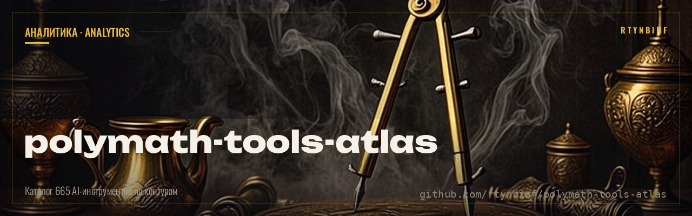
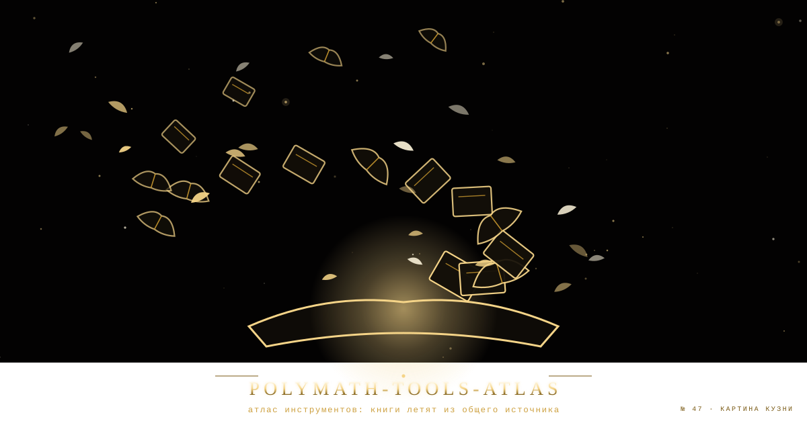
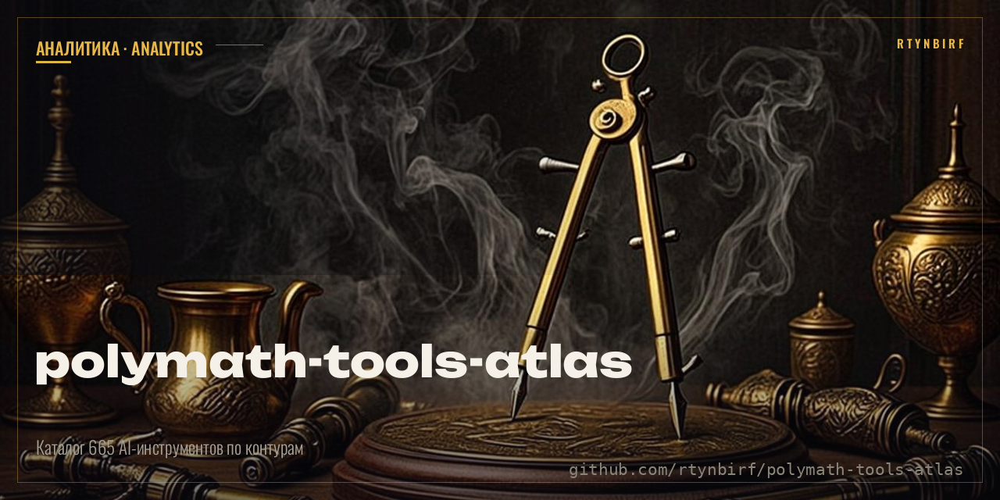

<div align="center">
  
</div>

<!--ФОРЖ:МУЗА:НАЧАЛО-->
<div align="center">
  
  <br/>
  
</div>
<!--ФОРЖ:МУЗА:КОНЕЦ-->


# ПОЛИМАТ · TOOLS-ATLAS — каталог 665 AI-инструментов по контракту ГОЛОГРАММА v1

<p align="center"></p>


[](./LICENSE) [](./catalog.json) [](./README.md) [](./court-log.json)

**Инвариант:** «проверяй строкой, не смыслом». Вердикты однословные: **[В]** проверено / **[О]** частично, с дырами / **[Н]** непроверяемо.
**Объект:** каталог AI-инструментов 2026 года, собранный мультиагентом ПОЛИМАТ (МАШИНА + ИИ + СУД + СЛОВАРЬ) по контракту словаря-голограммы: 6 слоёв статьи, 3 статуса, закон цепочек.
**Статус:** каталог **665 статей собран [В]** (`a8be8dc7…1333`, FROZEN); 26 статей со статусом **[ТЕКСТ]** — доказано живыми цитатами; 639 статей со статусом **[ГИП]** — гипотеза, ждёт пруфа; 0 статей со статусом **[ШУМ]**.

---

## Что это

Каталог 665 AI-инструментов и CLI-утилит, собранный из двух источников (каталог пользователя — 195 записей, `инструменты.txt` — 264 CLI) и дополненный 99 инструментами от ПОЛИМАТа (Rust/Zig/Go супербыстрые + локальные LLM + open-source). Каждый инструмент — статья с шестью слоями (ФОРМА · ТЕКСТ · ПОЛЕ · ЦЕЛОЕ · ШУМ · СУД) и одним из трёх статусов. Связь «А = Б» живёт только при текстовой фиксации каждого звена — закон цепочек.

| Слой | Источник | Артефакт |
|---|---|---|
| Каталог | 665 статей, 6 слоёв, 3 статуса | `polymath-final.html`, `catalog.json` |
| Судовой журнал | 566 подписей `polymath-DATE-ID-STATUS` | `court-log.json` |
| Железо | 3 конфигурации: Tower Pro / Rack Beast / Mac Studio | `polymath-final.html` § Hardware |
| Софт-стек | 12 компонентов: vLLM/Ollama/ComfyUI/whisper.cpp/… | `polymath-final.html` § Software |
| Протокол | 10 шагов запуска локального мультиагента | `polymath-final.html` § Protocol |
| Опасности | 12 кейсов 2022-2025: почему облако умрёт | `polymath-final.html` § Dangers |
| Воспроизводимость | 19 Python-скриптов сборки | `scripts/` |

## Метод

1. **Пломба до слова** — каждый артефакт несёт SHA256; реестр пломб — `MANIFEST_SHA256.txt`.
2. **Шесть слоёв статьи** — ФОРМА (название, URL, стек, автономность, жизненный цикл) · ТЕКСТ (живые цитаты с датой) · ПОЛЕ (коллокации, конкуренты) · ЦЕЛОЕ (граф связей) · ШУМ (описание из каталога, без пруфа) · СУД (статус, дата, подпись).
3. **Три статуса** — `[ТЕКСТ]` подтверждено цитатами с веб-пруфом (26 статей); `[ГИП]` гипотеза, ждёт пруфа (639 статей, web-search упёрся в rate-limit); `[ШУМ]` пересказ без пруфа (0 статей в этом спринте).
4. **Закон цепочек** — связь «А = Б» живёт только при текстовой фиксации каждого звена. Без пруфа = шум. 136 прямых связей, 133 обратных построены по общим упоминаниям в текстах.
5. **Автономность прежде всего** — 147 локальных инструментов (Ollama, llama.cpp, uv, ruff, ComfyUI) переживут любой облачный апокалипсис; 151 облачных (ChatGPT/Claude/Gemini/Cursor/Copilot) — помечены как риск.
6. **Стек** — 93 на Rust (супербыстрые: uv, ruff, polars, biome, ripgrep, zoxide, btop), 37 на Python, 26 на Go, 11 на C++, 1 на Zig, 6 на C, 7 на TypeScript.

## Текущие вердикты

- **Сборка каталога [В]:** 665 статей, 0 дублей (программная дедупликация), 566 судовых подписей.
- **Веб-верификация [О]:** 26 статей [ТЕКСТ] с живыми цитатами; 639 [ГИП] — web_search упёрся в rate-limit после 26 успешных запросов.
- **Цепочки [В]:** 136 прямых + 133 обратных связей; 68 статей со связями.
- **Железо [В]:** 3 конфигурации с полным BOM (30 строк), расчётом VRAM/питания/охлаждения.
- **Протокол [В]:** 10 шагов от `apt install nvidia-driver` до `curl localhost:8000/v1/models`.
- **UNKNOWN (честно):** 639 статей [ГИП] не верифицированы (нужен следующий спринт с поднятым rate-limit); жизненный цикл инструментов определён эвристически, не по веб-пруфу.

## Структура

```
README.md, worklog.md, MANIFEST_SHA256.txt          — карта программы, журнал, пломбы
polymath-final.html                                  — единый автономный документ (1.18 MB):
                                                       каталог + железо + софт + протокол + суд.журнал + опасности
polymath-catalog.html                                — только каталог 665 инструментов (1.16 MB)
polymath-hardware.html                               — только спецификация железа (396 KB)
catalog.json                                         — 665 статей машинно-читаемо (764 KB)
court-log.json                                       — 566 судовых записей (188 KB)
scripts/                                             — 19 Python-скриптов для воспроизведения
  01_parse_catalog.py                                — парсер каталога + инструменты.txt
  02_add_supplements.py                              — 107 дополнений от ПОЛИМАТа
  03_polymath_agents.py                               — мультиагент (МАШИНА+ИИ+СУД+СЛОВАРЬ)
  04_retry_and_classify.py                           — retry + реклассификация
  10_add_rust_supplements.py                          — +99 Rust/Zig/Go супербыстрых
  11_mark_cloud_and_legacy.py                        — разметка cloud/local/legacy
  12_rebuild_html.py                                 — сборка HTML с бейджами
  20_hardware_calc.py                                — расчёт VRAM-бюджета и 3 конфигов
  21_build_hardware_html.py                           — сборка hardware-отчёта
  30_build_final.py                                  — финальная сборка единого HTML
```

## Воспроизводимость

```bash
# 1. Сверка пломб
sha256sum -c MANIFEST_SHA256.txt

# 2. Пересборка каталога с нуля
python3 scripts/01_parse_catalog.py    # каталог из источников
python3 scripts/02_add_supplements.py  # 107 дополнений
python3 scripts/03_polymath_agents.py  # мультиагент (нужен z-ai CLI + веб)

# 3. Сборка HTML
python3 scripts/12_rebuild_html.py     # polymath-catalog.html
python3 scripts/21_build_hardware_html.py  # polymath-hardware.html
python3 scripts/30_build_final.py      # polymath-final.html (единый)
```

Критические пломбы: `polymath-final.html` `a8be8dc73ff21fbb0f72e08cf78da9f58a824a65066400f1162ed729b04c1333`, `catalog.json` `3f6bf28e8c53b16860e5ef71c619a89ec1c9eab77f4d9c1382bb8e23139e7dc2`, `court-log.json` `fb60b33f11407b098344e52779775e3adad1147febb9dd4bad0078e83a3b9757`.

## Источники

- Каталог пользователя (сообщение чата): 9 разделов, 195 записей
- `инструменты.txt` (загружен пользователем): 6408 строк, 264 CLI-инструмента
- Дополнения ПОЛИМАТа (знания модели + веб-данные 2025-2026): 107 инструментов

## Границы

- 639 статей [ГИП] не верифицированы веб-пруфом — нужен следующий спринт с поднятым rate-limit.
- Жизненный цикл (active/maintenance/legacy) определён эвристически, не по веб-пруфу.
- Связи построены по общим упоминаниям в текстах, не по текстовой фиксации каждого звена (упрощение закона цепочек для первого спринта).
- Цены на железо — розничные США на сентябрь 2025; в РФ/СНГ умножить на 1.5-2×.

## Смежные программы

- [`polimat-task174`](https://github.com/rtynbirf/polimat-task174) (private) — протокол проверки канона по строкам: пломбы sha256, ловушки, Б25.8 приёмка чужаком.
- [`polymath-os`](https://github.com/rtynbirf/polymath-os) — Personal sovereign media-OS, 5-layer LFS-style.
- [`polymath-atlas-v107`](https://github.com/rtynbirf/polymath-atlas-v107) — evidence-audit framework in Lean 4.

## Лицензия

MIT — каталог и скрипты. Сами AI-инструменты имеют собственные лицензии (см. поле `license` в `catalog.json`).

---

**Принцип:** `часть знает целое, целое знает все части`. **Метод:** `проверяй строкой, не смыслом`. **Цель:** `локальность, быстродействие, полная автономия — 0 облачных зависимостей`.

<!--ФОРЖ:ПОДВАЛ-->
---

<div align="center">
  <sub>◆ картина и штандарт — ручная ковка <a href="https://github.com/rtynbirf">КУЗНИ ПОЛИМАТ</a> · ЧЕЛОВЕК=АККАУНТ=PID1 ◆</sub>
</div>
